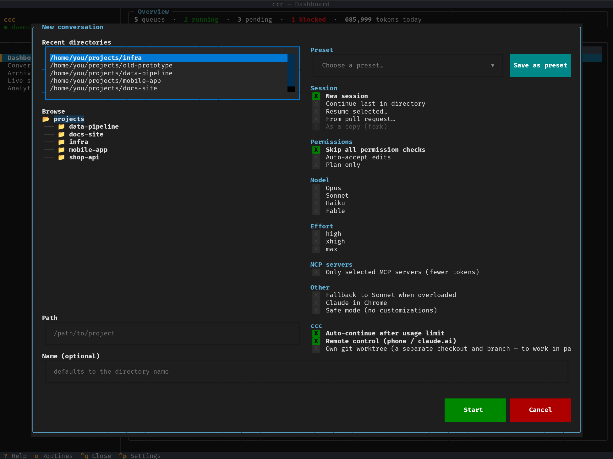
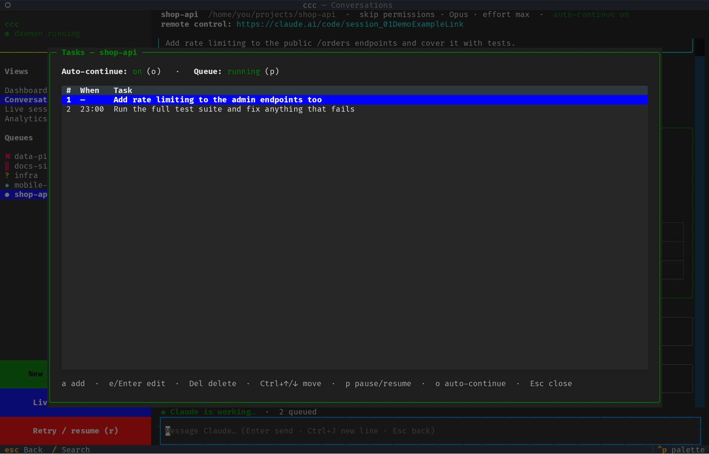
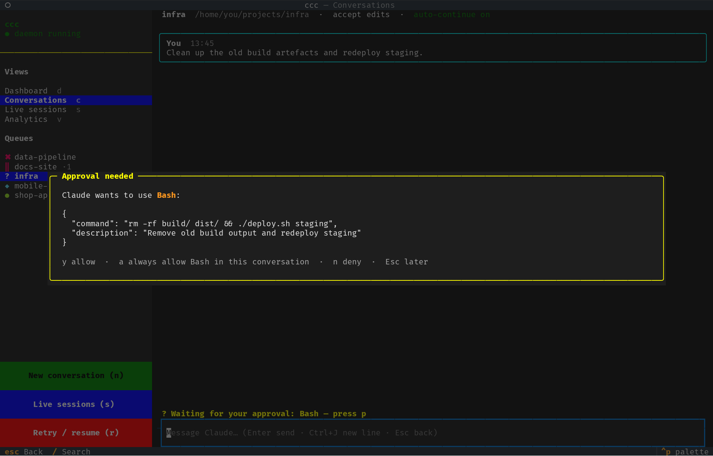
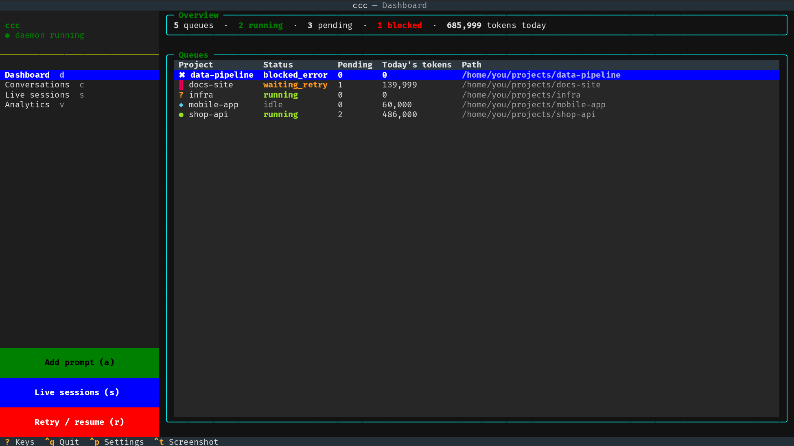
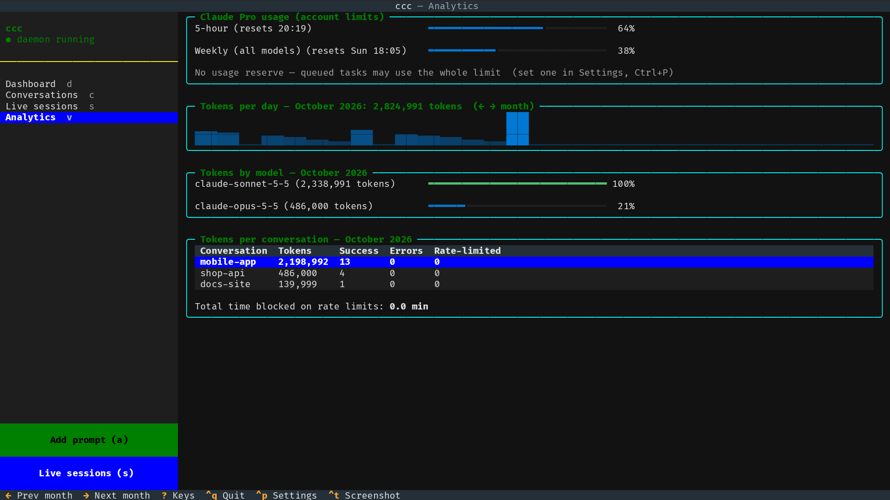
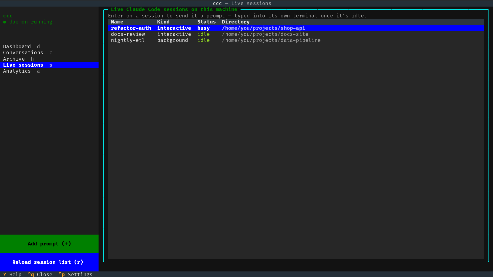
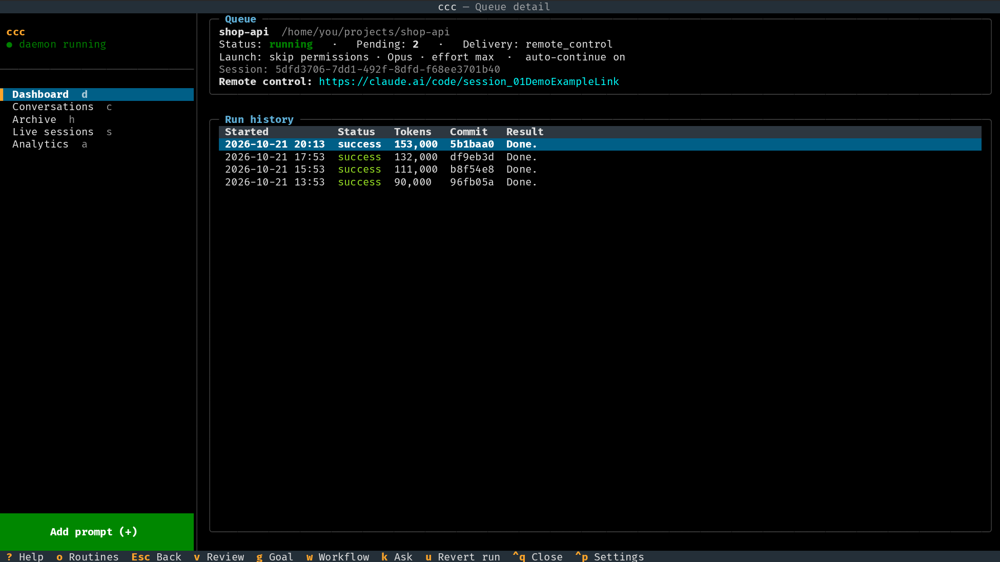
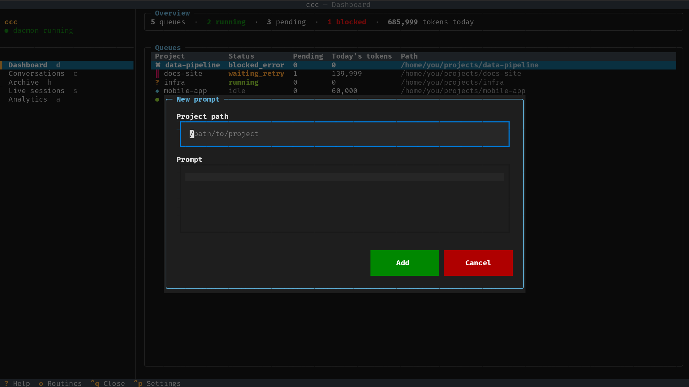
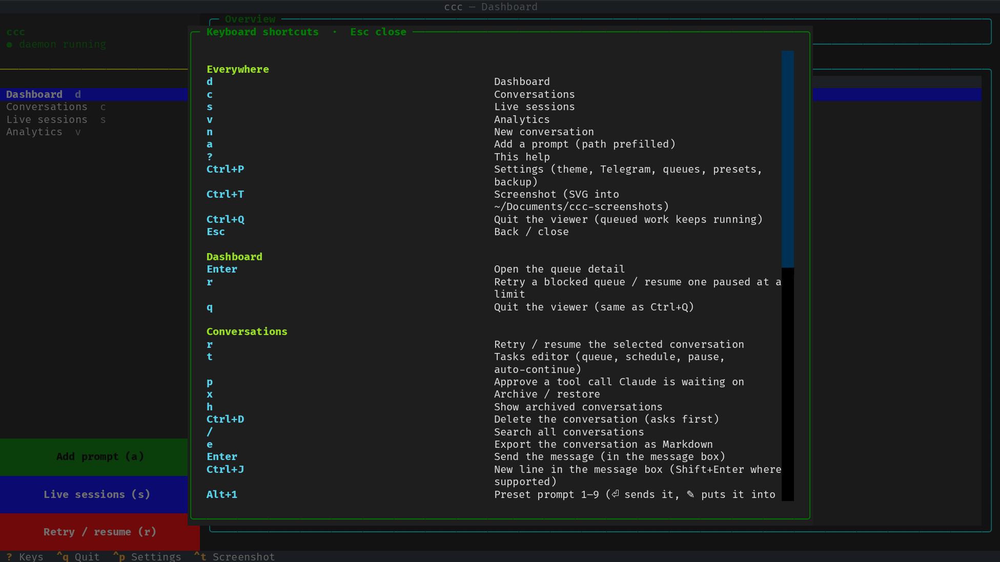
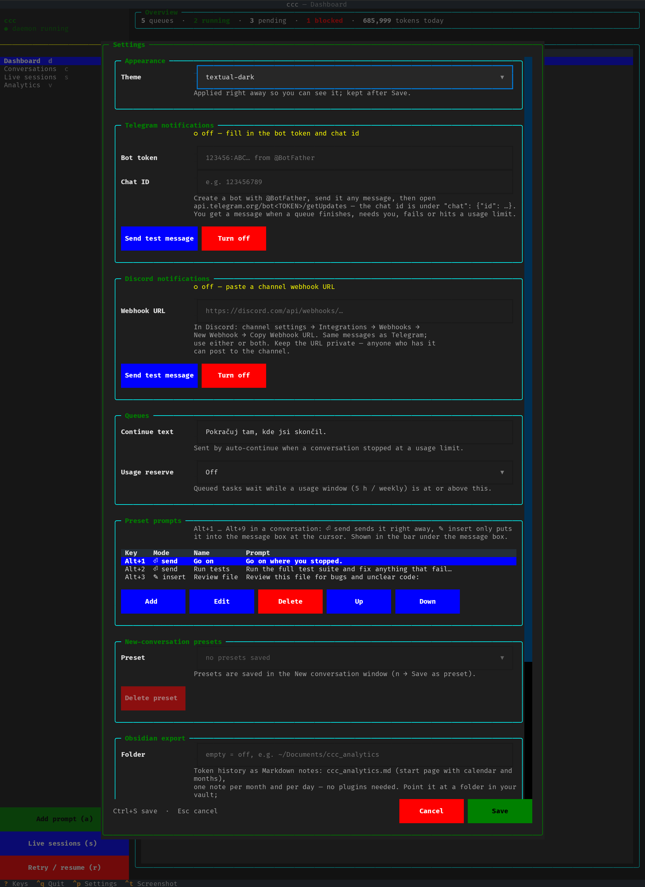

# ccc

**A terminal home for your Claude Code work that keeps going without you.**
Start conversations in any project, queue up tasks, and let a background
daemon work through them — it waits out usage limits and carries on by
itself, asks you (in the TUI, on Telegram or Discord) when Claude needs approval,
commits each finished task, and lets you continue a conversation from your
phone via Remote Control.


<table>
<tr>
<td></td>
<td></td>
</tr>
<tr>
<td align="center">Start a conversation: directory + Claude Code options</td>
<td align="center">Task queue: reorder, schedule, pause</td>
</tr>
<tr>
<td></td>
<td></td>
</tr>
<tr>
<td align="center">Approve a tool call Claude is waiting on</td>
<td align="center">Dashboard: what is running, waiting, blocked</td>
</tr>
<tr>
<td></td>
<td></td>
</tr>
<tr>
<td align="center">Settings: theme, Telegram, Discord, queues, presets, backup</td>
<td align="center">Analytics: account usage and token history</td>
</tr>
<tr>
<td></td>
<td></td>
</tr>
<tr>
<td align="center">Live sessions: every Claude Code session on the machine</td>
<td align="center">Queue detail: run history with commits</td>
</tr>
<tr>
<td></td>
<td></td>
</tr>
<tr>
<td align="center">Add a prompt to any project</td>
<td align="center"><code>?</code> lists every shortcut</td>
</tr>
</table>

## What it does

- **Conversations** — pick a directory, tick Claude Code options (model,
  effort, permission mode, resume / continue / fork / from PR), then chat
  in the TUI: Markdown replies, expandable tool calls, multi-line input.
- **Task queue** — queue many prompts per conversation; they run one after
  another in the same session. Reorder, edit, schedule (`23:00`, a date, or
  "after the next usage reset"), pause.
- **Usage limits** — reads your real Claude usage; waits for the reset and
  continues by itself (or pauses for you), sends "continue" instead of
  repeating an interrupted prompt; optional reserve so automation never
  eats your whole limit.
- **Remote Control** — conversations can run as a live
  `claude --remote-control` session you can also drive from the Claude
  mobile app / claude.ai.
- **Approvals** — restricted conversations (*Auto-accept edits*, *Plan
  only*) ask you in the TUI instead of silently failing.
- **Telegram / Discord** — notifications when a queue finishes, needs you, fails or
  hits a limit.
- **Git** — each successful task is committed (in *Skip all permission
  checks* conversations), with a diff viewer.
- **Live sessions** — see every Claude Code session running on the machine
  and send a prompt into one of them once it's idle.
- **Analytics** — the account's real 5-hour / weekly usage; tokens per
  calendar month by day, model and conversation, history kept for good —
  also as [Markdown notes for Obsidian](#token-history-in-obsidian) with
  a calendar and charts.
- **Preset prompts** — prompts you use often, on `Alt+1` … `Alt+9` in any
  conversation: each one is either sent right away or put into the message
  box for you to finish.
- **Settings** (`Ctrl+P`) — colour theme, Telegram, Discord, continue text, usage
  reserve, preset prompts, launch presets and database backup in one
  window.
- Search across conversations, Markdown export, archive/delete, daily
  database backups, screenshots (`Ctrl+T`), `?` shows every shortcut.

## Requirements

- Linux with `systemd --user` (for the always-on daemon; without it you can
  still run `ccc-daemon` yourself)
- Python **3.12+**
- [Claude Code](https://code.claude.com/docs) CLI
  (`claude`), installed and logged in (`claude` once, then `/login`) —
  ccc uses your normal Claude subscription login, no API key
- `tmux` (the always-on TUI and Remote Control conversations use it)
- `git` (optional — for auto-commit and diffs)

## Installation

```bash
git clone https://github.com/Luquas95/ccc.git ~/ccc
cd ~/ccc
bin/install.sh
```

`bin/install.sh` creates a virtualenv in the checkout, installs ccc into
it, writes two `systemd --user` units for this location — `ccc.service`
(the daemon that runs your tasks) and `ccc-tui.service` (the TUI, kept
alive in its own tmux session) — and enables and starts them. Options:
`--no-tui` (daemon only), `--no-start`, `--no-systemd` (just the
virtualenv).

So the services keep running after you log out or close SSH, enable
lingering once:

```bash
loginctl enable-linger "$USER"
```

Check that everything runs:

```bash
systemctl --user status ccc ccc-tui
journalctl --user -u ccc -f        # daemon log
```

## First steps

1. **Open the TUI:** `bin/ccc-tmux.sh` (attaches to the always-on
   session; detach with `Ctrl+B D`, it keeps running). Or run
   `.venv/bin/ccc` directly. The sidebar should say *● daemon running*.
2. **Start a conversation:** press `n`, choose a project directory, tick
   the options you want, *Start*.
3. **Talk to Claude:** type in the box at the bottom, `Enter` sends
   (`Ctrl+J` for a new line). Add more tasks with `t`.
4. Optional: press `Ctrl+P` (Settings) to pick a colour theme, set up
   [Telegram](#telegram-notifications) or [Discord](#discord-notifications)
   notifications and a
   [usage reserve](#usage-limits-and-auto-continue).

Press `?` anywhere for all keyboard shortcuts. You can also queue a
prompt from the shell without opening the TUI:

```bash
~/ccc/.venv/bin/ccc add /path/to/project "do the thing"
```

## Using the TUI

Every screen shares one layout. The **left sidebar** has the daemon state,
the list of screens (current one highlighted, each with its key, also
clickable), the screen's own list where it has one (conversations), and
coloured action buttons with their keys at the bottom. Content sits on
the right in round-bordered panels. The **bottom bar** only lists what
the sidebar doesn't already show: the current screen's own actions, plus
`?` Keys, `Ctrl+Q` Quit, `Ctrl+P` Settings and `Ctrl+T` Screenshot.

| Screen | Key | What it shows |
|---|---|---|
| Dashboard | `d` | every conversation with status, queued tasks, today's tokens; `Enter` opens its detail (settings, remote-control link, run history, commit diffs) |
| Conversations | `c` | the transcript of the selected conversation and a message box to continue it |
| Live sessions | `s` | Claude Code sessions running on this machine, also those started outside ccc; `Enter` sends one a prompt, `r` refreshes |
| Analytics | `v` | account usage (5-hour, weekly, per model); tokens per calendar month (`←` `→`) by day, model and conversation |

### Keyboard shortcuts

`?` on any screen shows this list too. Keys without `Ctrl` don't work while
you're typing in a text field; `Ctrl` keys work everywhere.

| Where | Key | |
|---|---|---|
| everywhere | `d` `c` `s` `v` | switch screen |
| | `n` | new conversation |
| | `a` | add a prompt (path prefilled from the selected conversation) |
| | `?` | all shortcuts |
| | `Ctrl+P` | [Settings](#settings) |
| | `Ctrl+T` | screenshot of the screen (SVG in `~/Documents/ccc-screenshots/`) |
| | `Ctrl+Q` | quit the viewer — queued work keeps running in the daemon |
| | `Esc` | back / close a window |
| Dashboard | `Enter` | queue detail (there: `Enter` on a run shows its commit diff) |
| | `r` | retry a blocked queue / resume one paused at a usage limit |
| Conversations | `Enter` / `Ctrl+J` | send the message / new line |
| | `Alt+1` … `Alt+9` | [preset prompt](#preset-prompts) — send it or put it into the message box |
| | `r` | retry / resume |
| | `t` | [task queue editor](#task-queue) |
| | `p` | [approve a tool call](#approving-tool-calls) Claude is waiting on |
| | `x` / `h` | archive or restore / show archived |
| | `Ctrl+D` | delete the conversation (asks first) |
| | `/` | search all conversations |
| | `e` | export as Markdown to `~/Documents/ccc-exports/` |

### Settings

`Ctrl+P` opens one window with everything you can change, grouped into
sections. Edit what you need, then `Ctrl+S` / *Save*; `Esc` / *Cancel*
throws the changes away, preset prompt edits included (the buttons *Send test message*, *Turn off*,
*Delete preset* and *Back up now* act immediately).

- **Appearance** — colour theme. It changes as soon as you pick one, so
  you see it right away; it's remembered after Save.
- **Telegram notifications** — bot token (hidden; leave the field empty to
  keep the saved one) and chat id, with how to get them. *Send test
  message* tries the values in the form before you save; *Turn off*
  clears both right away.
- **Discord notifications** — the channel's webhook URL (hidden; leave the
  field empty to keep the saved one), with how to get it, *Send test
  message* and *Turn off*. Only `https://discord.com/api/webhooks/…` URLs
  are accepted.
- **Queues** — the continue text auto-continue sends after a usage limit
  and the usage reserve (Off or 50–95 %), see
  [Usage limits](#usage-limits-and-auto-continue).
- **Preset prompts** — the list behind `Alt+1` … `Alt+9`, see
  [Preset prompts](#preset-prompts).
- **New-conversation presets** — delete presets saved in the New
  conversation window.
- **Obsidian export** — the folder for the [token history
  notes](#token-history-in-obsidian), *Export now*.
- **Data** — where the database and its backups are, when the last backup
  was made, and *Back up now*.

The same values can be set from the shell with `ccc config …` (see below).

<details>
<summary>The whole Settings window</summary>



</details>

### Preset prompts

Prompts you type again and again — "go on", "run the tests and fix what
fails", "review this file: " — can be saved once and used in any
conversation with `Alt+1` … `Alt+9` (works while you're typing too).

- **Set them up** in Settings (`Ctrl+P`) → *Preset prompts*: *Add* /
  *Edit* (or Enter on a row) opens a small editor with a **name** (shown in
  the bar), the **prompt** (multi-line) and **Send right away (with
  Enter)**. *Up* / *Down* change the order, which decides the number:
  the first is `Alt+1`. Up to 9; saved with the rest of Settings.
- **Use them:** under the message box a bar lists them, e.g.
  `Alt+1 ⏎ Go on   Alt+2 ⏎ Run tests   Alt+3 ✎ Review file`. Press the key
  or click the item.
  - `⏎` **send** — the prompt goes to the conversation at once (queued
    like a message sent with Enter). Whatever you had typed stays in the
    box.
  - `✎` **insert** — the prompt is put into the message box at the cursor,
    so you can finish it (e.g. add a file name) and send with Enter.
- Without presets the bar is hidden; `Alt+N` without a preset just tells
  you so.
- Most terminals (tmux, Termux, …) send `Alt+N` as the character macOS
  types for Option+N (`Alt+6` = `§`). While you type in the message box,
  such a character is typed normally when there's no preset on that
  number — but with 6 or more presets, `§` (a plain key on the Czech
  keyboard) runs preset 6.


### Screenshots

`Ctrl+T` saves what the TUI shows as an SVG file in
`~/Documents/ccc-screenshots/` (open it in any browser); the notification
shows the path.

### Two delivery modes

- **Headless** (default for `add`/`a`) — the daemon runs
  `claude -p --resume` as a separate subprocess. Safe, gives real
  structured results (tokens, cost, success/failure), but the response
  only ever shows up in ccc's own history — never in a terminal.
- **Live terminal** (`s` → pick a session → send) — for continuing a
  session you're actively watching in a tmux pane. The daemon waits until
  `claude agents --json` reports that session idle and not blocked on a
  usage limit, then types the prompt directly into its tmux pane via
  `tmux send-keys`, so it visibly continues that conversation. **This is
  the riskier mode**: there's no reliable way to detect "a human is
  mid-typing something else in that pane right now" — only "Claude itself
  is idle" — so a delivery can in principle interleave with something you
  were about to type. No structured result comes back either (only
  "delivered" or "failed"); the actual response appears in that terminal,
  not in ccc.

### Starting a new conversation

Press `n` anywhere (or the green **New conversation** button in the
conversations view). The dialog has:

- **Directory** — recent directories, a directory tree from `~/DEV`, or
  type a path.
- **Attributes** to tick (groups marked *one* are exclusive):

  | Group | Options |
  |---|---|
  | Session (*one*) | New session · Continue last in directory · Resume selected… (pick from that directory's past sessions) · From pull request… (`--from-pr`) |
  | | As a copy (fork) — `--fork-session`, with any of the resuming options |
  | Permissions (*one*) | Skip all permission checks · Auto-accept edits · Plan only |
  | Model (*one*) | Opus · Sonnet · Haiku · Fable |
  | Effort (*one*) | high · xhigh · max |
  | Other | Fallback to Sonnet when overloaded · Claude in Chrome · Safe mode |

After **Start** the conversation opens in the conversations view; type in
the box under the transcript and press Enter. Each message is queued and
run by the daemon as `claude -p --resume … <your attributes>`, so
conversations started here also keep going across usage limits and with
the TUI closed. While a message waits it shows as a grey *queued* bubble;
the status line says whether Claude is working, waiting for a limit reset,
or blocked.

Because runs are headless, Claude can't ask you to approve a tool mid-run
and interactive slash commands aren't available — choose the permission
mode up front. Resuming a session that already has a conversation in
ccc just switches to it (unless you fork). A fork / from-PR
conversation adopts the new session id Claude Code returns on its first
run.

### Remote control (phone / claude.ai)

*Remote control* in the New conversation dialog is ticked by default.
Such a conversation doesn't run headless message by message: the daemon
keeps an interactive `claude --remote-control <name>` running for it in a
hidden tmux server (`tmux -L ccc-sessions`, session `q<id>`), so
you can also continue it from the Claude mobile app or claude.ai — the
link appears in the conversation header and the queue detail. (Headless
`claude -p` silently ignores `--remote-control`; it needs a live process.)

- Messages from the TUI and the task queue are pasted into it once Claude
  is idle (multi-line prompts as a single paste). Messages sent from the
  phone show up in the same transcript.
- The daemon starts the process after the conversation is created, after
  a daemon restart, and if it dies (`--resume` keeps the history); it
  accepts the folder-trust dialog only right after starting it, never
  any tool-permission prompt. Archiving (`x`) or deleting stops it.
- Usage limits: if the session gets blocked mid-work, a continue message
  is queued first and sent after the reset (auto-continue) or when you
  press `r`.
- Each such conversation keeps a Claude Code process in memory; archive
  the ones you don't use.
- Token usage: an interactive session returns no structured result, so
  the daemon reads the tokens of every reply (subagents included) from the
  session's transcript every ~30 s and counts them in Analytics and the
  dashboard — also replies to messages sent from the phone. Only replies
  since the conversation was created in ccc count.

### Approving tool calls

Headless conversations started with *Auto-accept edits* or *Plan only*
don't silently lose tool calls that need permission: ccc attaches its own
permission MCP server (`--permission-prompt-tool mcp__ccc__approve`), so
Claude's request waits — with no time limit — for you. The conversation
shows `?` in the lists and *Waiting for your approval: Bash — press p*;
`p` opens the request: `y` allow, `a` always allow that tool in this
conversation, `n` deny (Claude is told and adapts), `Esc` decide later.
A Telegram / Discord message tells you when a request is waiting. Conversations
with *Skip all permission checks* approve everything as before;
remote-control ones are approved inside the session (phone / claude.ai).

### Telegram notifications

The daemon can message you on Telegram when a conversation **finished its
queue** (with the start of the reply), **needs you** (paused at a usage
limit with auto-continue off), **stopped on an error**, or **hit a usage
limit** (waiting until HH:MM) and later **continues**.

1. Create a bot with [@BotFather](https://t.me/BotFather) (`/newbot`) and
   copy its token.
2. Send your bot any message, then open
   `https://api.telegram.org/bot<TOKEN>/getUpdates` and copy
   `"chat":{"id": …}`.
3. Fill both in [Settings](#settings) (`Ctrl+P`) and press *Send test
   message*, then *Save*. Or from the shell:

       ccc config telegram-token <TOKEN>
       ccc config telegram-chat <CHAT_ID>
       ccc config telegram-test

Without both values nothing is sent. The token is stored in the ccc
database, shown masked, and never logged.

### Discord notifications

The same messages can go to a Discord channel — instead of Telegram or
next to it (each channel works on its own).

1. In Discord open the channel's settings → *Integrations* → *Webhooks* →
   *New Webhook* → *Copy Webhook URL*.
2. Paste it in [Settings](#settings) (`Ctrl+P`) → *Discord notifications*,
   press *Send test message*, then *Save*. Or from the shell:

       ccc config discord-webhook https://discord.com/api/webhooks/…
       ccc config discord-test

`ccc config discord-webhook off` (or *Turn off*) removes it. Keep the URL
private: anyone who has it can post to the channel. It's stored in the ccc
database, shown masked and never logged. Messages are cut to Discord's
2000 characters and never ping anyone (`@everyone` in a reply stays plain
text).

### Usage limits and auto-continue

Each conversation has an **auto-continue** switch (on by default; a
checkbox in the New conversation dialog, `o` in the Tasks editor).

- The daemon reads the account's real usage (5-hour, weekly and any
  per-model window — the same figures as the Analytics screen). Before it
  starts a message it checks them: while a window is used up it doesn't
  even start Claude, it waits for that window's reset (+30 s).
- After Claude Code reports a usage limit (429), the wait is the busiest
  window's reset; if usage can't be read it falls back to the time in the
  error message, then to a 15→30→60 min backoff.
- **Auto-continue on:** after the reset the conversation carries on by
  itself. **Off:** it stops in `paused_limit` and waits for you — press `r`
  or just send another message.
- If the limit cut a message off after it had reached the conversation,
  the retry sends a short continue message instead of repeating it
  (default *Pokračuj tam, kde jsi skončil.*). Change it in Settings, or
  with `ccc config continue-text "…"` (without a value it prints it).
- Waiting survives daemon restarts (the reset time is stored).
- **Usage reserve:** set in Settings, or `ccc config usage-reserve 80` —
  keeps the top of your limit for yourself — queued tasks don't start while the 5-hour or weekly
  window is at or above 80%, and continue after that window resets (a
  running task finishes). `ccc config usage-reserve off` turns it off
  (default). The Analytics screen shows the current setting.

### Auto-commit and diffs

In a git repository, every successful headless task is committed:
`ccc: <first line of the task>` with a `ccc-conversation: <name>`
trailer. It's skipped — and the reason recorded — when the working tree
already had uncommitted changes before the task (that's your work, it is
never swept into a ccc commit), on a detached HEAD, or when nothing
changed. Auto-commit only happens in conversations started with *Skip all
permission checks*: the daemon runs git outside Claude's permission mode,
so in an *Auto-accept edits* / *Plan only* conversation Claude could
otherwise plant a git hook or config that ccc would execute for it. Every
git call also disables hooks, fsmonitor, signing programs, external
diff/textconv and the pager; and if the repo's own config defines
filters, includes or signing — or changes during the task — ccc runs no
further git there and records why. The queue detail shows a *Commit* column; Enter on a run opens
the commit's stat and coloured diff.

### Task queue

A conversation works through its queued messages one after another, in
the same session — the next starts as soon as Claude finishes the previous
one. Press `t` in the conversations view to edit that queue:

| Key | |
|---|---|
| `a` | add a task (multi-line editor, `Ctrl+S` save, `Esc` cancel) |
| `e` / `Enter` | edit the selected task |
| `Delete` | remove it (kept in history as skipped) |
| `Ctrl+↑` / `Ctrl+↓` | move it up / down |
| `p` | pause / resume the queue (a running task finishes) |
| `o` | toggle auto-continue |

The message box under the transcript adds to the end of the same queue.

**Scheduling:** the task editor has a *Run at* field — empty (as soon as
possible), `HH:MM` (today, or tomorrow if that time has passed),
`YYYY-MM-DD HH:MM`, or `reset` (after the next 5-hour usage window
reset). A scheduled task keeps its place in the queue, so the tasks
behind it wait too; the task list shows a *When* column and the status
line says when the next task starts.

### Conversation list: markers, archive, delete

Each conversation in the list (and on the dashboard) shows what it's doing:
`●` Claude is working · `‖` waiting for a usage-limit reset / paused ·
`✖` blocked on an error · `◆` a new reply you haven't looked at yet —
followed by `·N` queued tasks.

In the conversations view: `x` archives the selected conversation (hidden
from the lists, still processed; `h` shows archived ones, `x` again
restores), `Ctrl+D` deletes it after confirmation — its queued tasks and the texts
of its runs go, its token numbers stay in the history (Analytics and the
Obsidian notes show it as *deleted*), Claude Code's own transcript stays (so it can still be
picked under *Resume selected…*). A conversation Claude is working on
can't be deleted until it finishes or you pause it.

### Reading, searching, exporting

Claude's replies render as Markdown; a tool call is a collapsed `▸ ⚙
Tool: …` line — Enter/click shows its full input and its result. The
message box under the transcript is multi-line: Enter sends, Ctrl+J (or
Shift+Enter where the terminal reports it) starts a new line. In the
conversations view `/` searches every conversation (archived too) and
Enter on a hit opens it; `e` exports the selected conversation as
Markdown to `~/Documents/ccc-exports/`. The sidebar shows whether the
daemon is running. The New conversation dialog remembers your last
choice and can save it as a named preset.

### Conversations view

Press `c` on the dashboard to see a queue's full conversation — not just
the last result. Arrow keys in the left-hand queue list immediately
switch which queue's transcript is shown on the right. This reads Claude
Code's own JSONL session transcript
(`~/.claude/projects/**/<session_id>.jsonl`) directly, so it works
identically for headless and live-terminal queues, and stays live: while
the screen is open, the currently-shown queue's transcript is re-checked
every ~2s for new messages (e.g. from a live-terminal session someone is
actively typing in).

### Live sessions

The Live sessions screen (`s`) lists every Claude Code session on the
machine (`claude agents --json`) — also the ones you started in a terminal
outside ccc — with its status and directory. `Enter` on one sends it a
prompt in [live-terminal mode](#two-delivery-modes); `r` refreshes the
list. ccc's Dashboard and Conversations only show conversations ccc
manages; a session from the terminal appears there once you send it a
prompt this way.

### Analytics

Analytics (`v`) shows the account's real usage windows (the same numbers
the daemon uses to wait for resets) with their reset times and your usage
reserve, then what ccc itself used in a **calendar month** — `←` / `→`
switch months: tokens per day, tokens by model and a per-conversation
table (successes, errors, rate-limited runs). Tokens include headless runs
and the replies of remote-control conversations; sessions started outside
ccc aren't counted. The history is kept for good — also for conversations
you delete.

### Token history in Obsidian

ccc can write the token history as Markdown notes into a folder of your
Obsidian vault — no plugins needed (Obsidian draws the charts itself):

| Note | What's in it |
|---|---|
| `ccc_analytics.md` | start page: total, this month's calendar (click a day), all months with links, chart per month |
| `2026-10.md` | a month: total, calendar, chart per day, by model, by conversation |
| `2026-10-15.md` | a day with usage: total, by model, by conversation |

Set the folder in Settings → *Obsidian export* (or `ccc config
obsidian-folder ~/path/to/vault/ccc_analytics`); *Export now* /
`ccc export-obsidian` write the notes at once, then the daemon keeps them
up to date every 5 minutes. The numbers live in the ccc database — the
notes are a view: ccc overwrites notes it made (they carry `generator: ccc`
in their properties) and never touches any other file. Each note also has
its numbers as properties (`tokens`, `date` / `month`).

## Command line

The commands live in the checkout's virtualenv (`~/ccc/.venv/bin/`); add
that to your `PATH` or call them with the full path.

| Command | |
|---|---|
| `ccc` | open the TUI |
| `ccc add <dir> "<prompt>"` | queue a prompt for that directory's conversation |
| `ccc backup` | back up the database now |
| `ccc export-obsidian` | write the token history notes into the Obsidian folder now |
| `ccc config obsidian-folder [PATH\|off]` | show / set / clear the folder for the Obsidian notes |
| `ccc config continue-text ["…"]` | show / set the continue message |
| `ccc config usage-reserve [N\|off]` | show / set the usage reserve |
| `ccc config telegram-token [TOKEN]` | show (masked) / set the bot token |
| `ccc config telegram-chat [ID]` | show / set the chat id |
| `ccc config telegram-test` | send a test notification to Telegram |
| `ccc config discord-webhook [URL\|off]` | show (masked) / set / remove the Discord webhook |
| `ccc config discord-test` | send a test notification to Discord |
| `ccc-daemon` | the daemon (normally run by `ccc.service`) |

## Architecture: daemon vs. TUI

- **`ccc-daemon`** is the only thing that ever executes prompts.
  It's a headless asyncio process — no TUI, no TTY needed — so it can run
  as a real `systemd --user` service that survives SSH logout, crashes
  (auto-restart), and reboots.
- **`ccc`** (the TUI) is a pure viewer/editor: it reads and writes
  the same SQLite database, but never runs a prompt itself. Open it in a
  tmux window when you want to look at something or queue a prompt
  interactively; close it any time — the daemon keeps working regardless.
- Both talk to the same SQLite file, safely: `queue_items` are claimed
  with an atomic `UPDATE ... RETURNING`, so even if you ran two daemons
  by mistake, a prompt is never executed twice.

Headless runs authenticate the same way as your interactive sessions
(OAuth login, not a separate API key) and draw from the **same shared**
5-hour/weekly Pro usage pool as every other Claude Code session on this
machine — there is no separate billing path. The `cost_usd` figures in
the analytics screen are Anthropic's list-price-equivalent for
observability, not an extra charge.

## Running notes

**The always-on TUI** runs in its own tmux server (`tmux -L ccc`), so it
doesn't show up in plain `tmux ls`: attach with `bin/ccc-tmux.sh` or
`tmux -L ccc attach -t ccc`. Quitting the TUI (`Ctrl+Q`) just restarts it a
second later; the daemon is unaffected either way. Using a separate tmux
server is deliberate — if the unit started your default one, all your
other tmux sessions would live in its cgroup and systemd-oomd killing it
would take them all down. If the session dies anyway, the unit recreates
it within ~5 s.

**Encrypted home (ecryptfs):** linger alone isn't enough — the user
systemd manager starts at boot, before login, while
`~/.config/systemd/user/` is still unreadable, so the units silently never
start. Start them at login instead, e.g. with an XFCE/GNOME autostart
entry that runs:

    systemctl --user daemon-reload
    systemctl --user start ccc.service ccc-tui.service

## Reliability notes

- A queue only blocks (`blocked_error`) on a genuine hard error (bad
  prompt, tool failure, session gone) — never silently loops burning your
  usage limit. Clear it with `r` in the TUI once you've looked at it.
- A real usage-limit hit is detected via `api_error_status == 429` in
  Claude Code's own JSON output (not message-text guessing), and the
  reset time is parsed from the message when present; otherwise it falls
  back to an escalating 15→30→60 min retry.
- New projects queued while the daemon is already running are picked up
  automatically (checked every ~5s), no restart needed.

## Backups

The daemon backs up the database once a day (checked hourly) to
`~/.local/share/ccc/backups/history-YYYY-MM-DD.db` using SQLite's online
backup, so the copy is consistent while it runs; the newest 14 are kept,
files are private (600) since they include settings such as the Telegram
token and the Discord webhook. *Back up now* in Settings or `ccc backup` makes one immediately. To restore: stop the services,
copy a backup over `~/.local/share/ccc/history.db`, start them again.

## Updating

```bash
cd ~/ccc && git pull && bin/install.sh
```

Your data (`~/.local/share/ccc/`: history, settings, backups) is kept.

## Uninstalling

```bash
systemctl --user disable --now ccc ccc-tui
rm ~/.config/systemd/user/ccc.service ~/.config/systemd/user/ccc-tui.service
systemctl --user daemon-reload
rm -rf ~/ccc                    # the checkout
rm -rf ~/.local/share/ccc       # history, settings, backups (optional)
```

## Tests

```bash
.venv/bin/pip install -e ".[dev]"
.venv/bin/pytest -q
```

README screenshots are rendered from made-up demo data, never from real
conversations.
