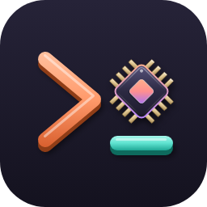

<p align="center"></p>

# ccc

**A terminal home for your Claude Code work that keeps going without you.**
Start conversations in any project, queue up tasks, and let a background
daemon work through them — it waits out usage limits and carries on by
itself, asks you (in the TUI, on Telegram or Discord) when Claude needs approval,
commits each finished task, and lets you continue a conversation from your
phone via Remote Control.


<table>
<tr>
<td></td>
<td></td>
</tr>
<tr>
<td align="center">Start a conversation: directory + Claude Code options</td>
<td align="center">Task queue: reorder, schedule, pause</td>
</tr>
<tr>
<td></td>
<td></td>
</tr>
<tr>
<td align="center">Approve a tool call Claude is waiting on</td>
<td align="center">Dashboard: what is running, waiting, blocked</td>
</tr>
<tr>
<td></td>
<td></td>
</tr>
<tr>
<td align="center">Settings: language, Telegram, Discord, queues, presets, backup</td>
<td align="center">Analytics: account usage and token history</td>
</tr>
<tr>
<td></td>
<td></td>
</tr>
<tr>
<td align="center">Live sessions: every Claude Code session on the machine</td>
<td align="center">Queue detail: run history with commits</td>
</tr>
<tr>
<td></td>
<td></td>
</tr>
<tr>
<td align="center">Add a prompt to any project</td>
<td align="center"><code>?</code> opens the guide on the screen you're on</td>
</tr>
</table>

## What it does

- **Conversations** — pick a directory, tick Claude Code options (model,
  effort, permission mode, resume / continue / fork / from PR), then work
  with the real Claude Code right beside ccc's menu; it keeps running when
  you close ccc.
- **Task queue** — queue many prompts per conversation; they run one after
  another in the same session. Reorder, edit, schedule (`23:00`, a date, or
  "after the next usage reset"), pause.
- **Usage limits** — reads your real Claude usage; waits for the reset and
  continues by itself (or pauses for you), sends "continue" instead of
  repeating an interrupted prompt; optional reserve so automation never
  eats your whole limit.
- **Remote Control** — conversations can run as a live
  `claude --remote-control` session you can also drive from the Claude
  mobile app / claude.ai.
- **Approvals** — restricted conversations (*Auto-accept edits*, *Plan
  only*) ask you in the TUI instead of silently failing.
- **Telegram / Discord** — notifications when a queue finishes, needs you, fails or
  hits a limit.
- **Git** — each successful task is committed (in *Skip all permission
  checks* conversations), with a diff viewer.
- **Live sessions** — see every Claude Code session running on the machine
  and send a prompt into one of them once it's idle.
- **Analytics** — the account's real 5-hour / weekly usage; tokens per
  calendar month by day, model and conversation, history kept for good —
  also as [monthly archive of Markdown notes for Obsidian](src/ccc/help/analytics.md) with
  a calendar and charts.
- **Preset prompts** — prompts you use often, on `Alt+1` … `Alt+9` in any
  conversation: each one is either sent right away or put into the message
  box for you to finish.
- **Settings** (`Ctrl+P`) — language, Telegram, Discord, continue text, usage
  reserve, preset prompts, launch presets and database backup in one
  window.
- **Routines** (`o`) — prompts queued on a schedule (every N minutes, daily,
  on weekdays, weekly, cron), into their conversation or a new one every
  run; the daemon runs them with ccc closed too, catches up a missed run once.
- **Reviews** (`v`) — a fresh-context reviewer checks what a conversation
  changed and says PASS / FAIL / PARTIAL; once, or until it passes (the
  findings go back as a task); `ccc review --wait` for CI.
- **Goal loop** (`g`) — say once what done looks like; the conversation
  works in rounds (task → your check command → fresh review) until the
  reviewer says it's met, switching to stronger models when it stalls.
- **Workflows** (`w`) — a chain of agents on one task: planner, your
  approval, the build, a check, reviewers in parallel and an arbiter, with
  bounded rounds back to the build; your own templates as JSON.
- **Conversations ask each other** (`k`, or Claude by itself through the
  ccc tool `ask_conversation`) — the answer comes back as the next
  message; never blocking, no circles.
- **Your own keyboard shortcuts** — every key can be changed (Settings or
  `ccc keys`), each new one is checked for collisions with ccc, Claude
  Code and the terminal first; export / import them as `ccc-keys.json`.
- Search across conversations, Markdown export, archive/delete, daily
  database backups, and a built-in guide: `?` on any screen.

## Requirements

- Linux with `systemd --user` (for the always-on daemon; without it you can
  still run `ccc-daemon` yourself)
- Python **3.12+**
- [Claude Code](https://code.claude.com/docs) CLI
  (`claude`), installed and logged in (`claude` once, then `/login`) —
  ccc uses your normal Claude subscription login, no API key
- `tmux` (the always-on TUI and Remote Control conversations use it)
- `git` (optional — for auto-commit and diffs)

## Installation

```bash
git clone https://github.com/Luquas95/ccc.git ~/ccc
cd ~/ccc
bin/install.sh
```

`bin/install.sh` creates a virtualenv in the checkout, installs ccc into
it, writes two `systemd --user` units for this location — `ccc.service`
(the daemon that runs your tasks) and `ccc-tui.service` (the TUI, kept
alive in its own tmux session) — and enables and starts them. Options:
`--no-tui` (daemon only), `--api` (also the [API for the Android
app](src/ccc/help/android-api.md)), `--no-start`, `--no-systemd` (just the
virtualenv). It also adds a "ccc" entry with the logo to your application menu.

So the services keep running after you log out or close SSH, enable
lingering once:

```bash
loginctl enable-linger "$USER"
```

Check that everything runs:

```bash
systemctl --user status ccc ccc-tui
journalctl --user -u ccc -f        # daemon log
```

## First steps

1. **Open ccc:** `ccc` in any terminal, local or over SSH. There's only
   ever one ccc — every terminal shows the same screen; `Ctrl+Q` closes it
   there and it keeps running. The sidebar warns only if the daemon is *not running*.
2. **Start a conversation:** press `n`, choose a project folder, tick the
   options you want, *Start*. Claude Code opens beside ccc's menu.
3. **Queue more work:** press `t` and add tasks — they run one after
   another, also while ccc is closed.

Press `?` on any screen for the guide.

## Help

The guide inside ccc (`?`) is also here on GitHub, with screenshots
([česky](src/ccc/help/cs/README.md) — ccc speaks Czech too: Settings →
Language):

- [Getting started](src/ccc/help/getting-started.md)
- [Dashboard](src/ccc/help/dashboard.md)
- [Conversations](src/ccc/help/conversations.md)
- [Starting a conversation](src/ccc/help/new-conversation.md)
- [Task queue](src/ccc/help/tasks.md)
- [Routines](src/ccc/help/routines.md)
- [Reviews](src/ccc/help/review.md)
- [Goal loop](src/ccc/help/goal.md)
- [Workflows](src/ccc/help/workflows.md)
- [Conversations asking each other](src/ccc/help/asking.md)
- [Archive](src/ccc/help/archive.md)
- [Usage limits & blocked queues](src/ccc/help/limits.md)
- [Approving tool calls](src/ccc/help/approvals.md)
- [Remote control (phone)](src/ccc/help/remote-control.md)
- [Android app & API](src/ccc/help/android-api.md)
- [Live sessions](src/ccc/help/live-sessions.md)
- [Analytics](src/ccc/help/analytics.md)
- [Settings & notifications](src/ccc/help/settings.md)
- [Git: auto-commit & diffs](src/ccc/help/git.md)
- [Command line](src/ccc/help/command-line.md)
- [Troubleshooting & how it works](src/ccc/help/troubleshooting.md)
- [Keyboard shortcuts](src/ccc/help/keys.md)

## Updating

```bash
cd ~/ccc && git pull && bin/install.sh
```

Your data (`~/.local/share/ccc/`: history, settings, backups) is kept.

## Uninstalling

```bash
systemctl --user disable --now ccc ccc-tui
rm ~/.config/systemd/user/ccc.service ~/.config/systemd/user/ccc-tui.service
systemctl --user daemon-reload
rm -f ~/.local/share/applications/ccc.desktop ~/.local/share/icons/hicolor/*/apps/ccc.*
rm -rf ~/ccc                    # the checkout
rm -rf ~/.local/share/ccc       # history, settings, backups (optional)
```

## Tests

```bash
.venv/bin/pip install -e ".[dev]"
.venv/bin/pytest -q
```

The guide lives in `src/ccc/help/` (one Markdown file per topic). After
changing the list of topics or a key, `.venv/bin/python -m ccc.help`
rewrites its generated pages (`README.md`, `keys.md`); a test checks
they're current.

README screenshots are rendered from made-up demo data, never from real
conversations.
