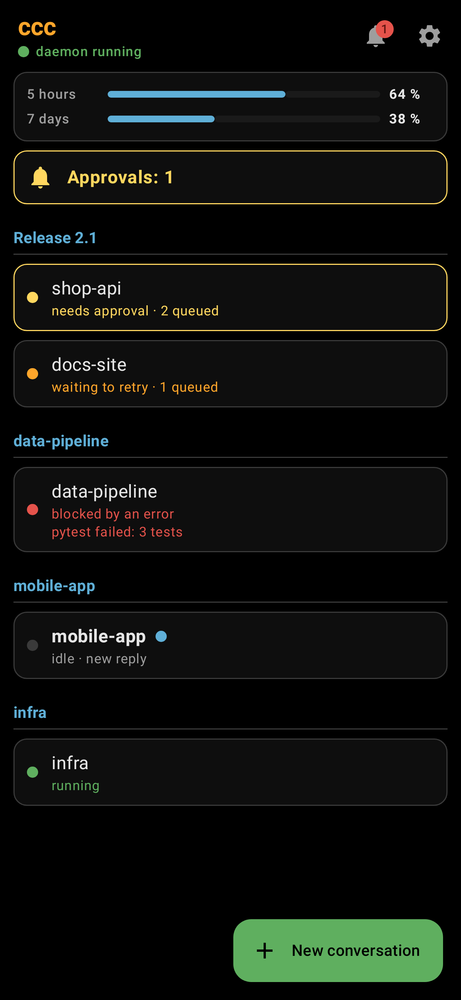
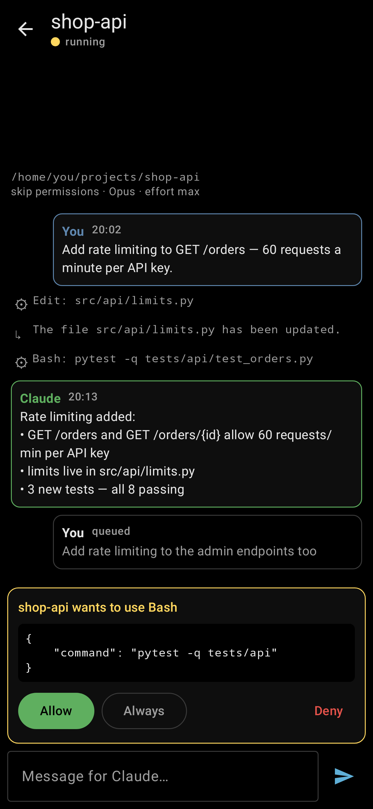
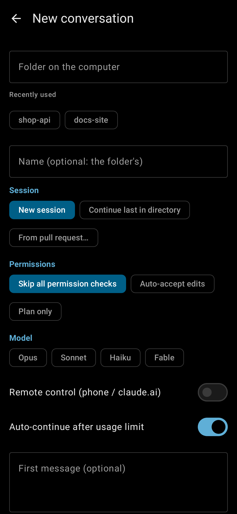

# ccc for Android

A native Android app for ccc (Kotlin, Jetpack Compose): your
conversations, their messages, sending a message, approving tool calls,
starting a conversation and the usage limits — from the phone, over
[Tailscale](https://tailscale.com). Black, like ccc in the terminal; in
English or Czech, as the phone is set.

It talks to ccc's HTTP API (`src/ccc/api.py`); turning the API on:
[Android app & API](../src/ccc/help/android-api.md).

| Conversations | A conversation | New conversation |
|---|---|---|
|  |  |  |

## What it does

- **Conversations** — in ccc's order and groups, each with its state,
  queued messages, "needs approval" and "new reply"; the usage limits on
  top. Pull down to reload.
- **A conversation** — Claude's replies, your messages, tool calls (tap
  one for the whole of it), older messages as you scroll up; write a
  message (it's queued, as in ccc); retry / resume a blocked or paused
  one.
- **Approvals** — Allow, Always (this tool in this conversation) or
  Deny, right in the conversation or all of them behind the bell.
- **New conversation** — a folder (recently used ones offered), the same
  options as ccc's New conversation window, remote control,
  auto-continue and a first message.
- **Live** — while the app is open it keeps ccc's event stream open: a
  new reply or approval shows up by itself. In the background it's
  closed (notifications are the next step).

## Building and installing

Needs JDK 17+ and the Android SDK (platform 36); Android 10 or newer on
the phone.

```bash
cd android
echo "sdk.dir=$HOME/Android/Sdk" > local.properties   # once
./gradlew assembleDebug
adb install -r app/build/outputs/apk/debug/app-debug.apk
```

Or copy `app-debug.apk` to the phone and open it there. Then enter the
address (`tailscale serve status` on the computer prints it, e.g.
`computer.tailnet.ts.net`) and the token (`ccc api token`).

The debug build also allows plain `http://` (e.g. ccc's API on the
computer's Tailscale IP and port 8737, without `tailscale serve`) —
Tailscale encrypts the traffic anyway.

## Tests

```bash
./gradlew testDebugUnitTest
```

The API client against a fake of ccc's API, the event stream, the
New conversation options — and `ScreenshotsTest`, which draws every
screen with made-up data (Robolectric) into
`app/build/screenshots/{en,cs}/`; the pictures in `screenshots/` come
from there.

## Plan (issue #49)

1. **API** in ccc — done.
2. **The app** — done: conversations, messages, sending, approvals, a
   new conversation, usage limits.
3. **Notifications** with Allow / Deny right in them.
4. The rest of ccc as needed (tasks, routines, reviews, archive …).
