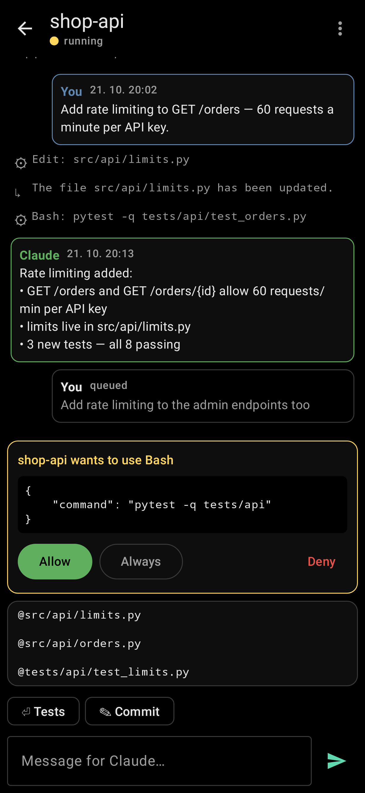
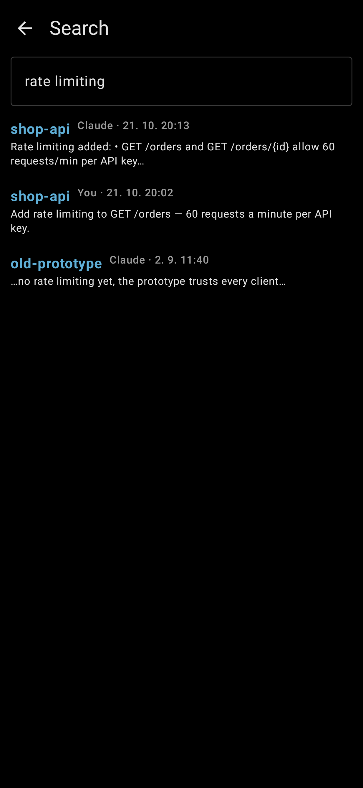
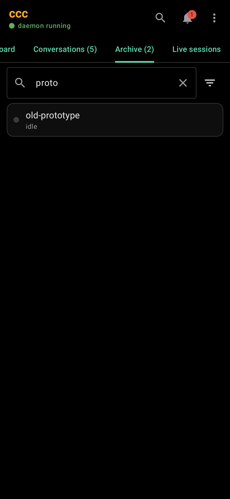
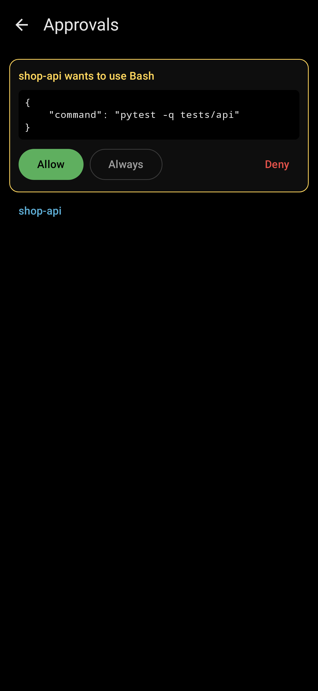
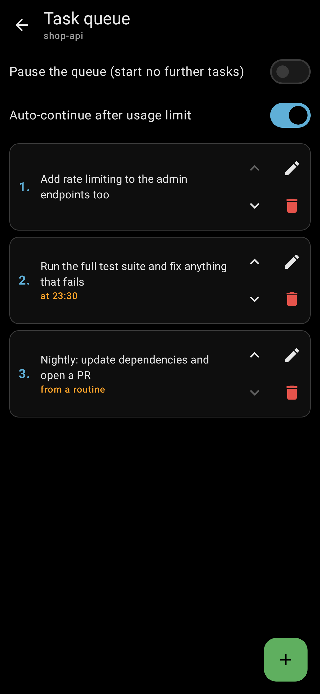
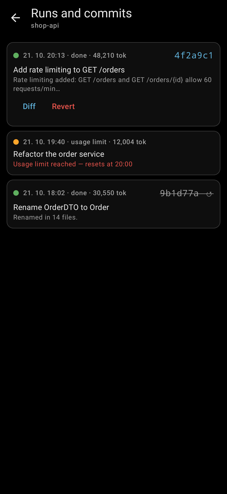
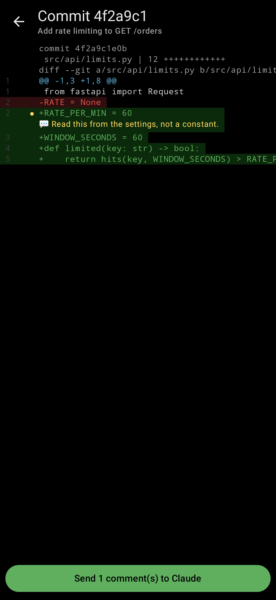

# ccc for Android

A native Android app for ccc (Kotlin, Jetpack Compose): your
conversations, their messages, sending a message, approving tool calls,
starting a conversation and the usage limits — from the phone, over
[Tailscale](https://tailscale.com). Black, like ccc in the terminal; in
English or Czech, as the phone is set.

It talks to ccc's HTTP API (`src/ccc/api.py`); turning the API on:
[Android app & API](../src/ccc/help/android-api.md).

| Conversations | A conversation | New conversation |
|---|---|---|
|  |  |  |
| **Search** | **Archive** | **Approvals** |
|  |  |  |
| **Task queue** | **Runs and commits** | **A diff with a comment** |
|  |  |  |

## What it does

- **Conversations** — in ccc's order and groups, each with its state,
  queued messages, "needs approval" and "new reply"; the usage limits on
  top, and **who needs you** (an approval, an error, a limit, a finished
  reply) with one tap to the next — Alt+N in ccc. Pull down to reload.
- **Filter** — name or folder, and the state chips `! working`,
  `? approval`, `x error`, `* new` — the same as `f` in ccc.
- **Search** (the magnifier) — every conversation's messages, archived
  ones too.
- **Archive** — the second tab; a conversation's menu archives it,
  restores it or deletes it from ccc.
- **Own groups** — a conversation's menu puts it into a group (or a new
  one); tap an own group's heading to rename or delete it.
- **A conversation** — Claude's replies, your messages, tool calls (tap
  one for the whole of it), older messages as you scroll up; write a
  message (it's queued, as in ccc), with **@-mentions** of the folder's
  files and the **preset prompts** (⏎ sent at once, ✎ put into the
  message); retry / resume a blocked or paused one; **export** it as
  Markdown to the share sheet (secrets masked).
- **Task queue** (a conversation's menu) — add, edit, reorder and
  remove tasks, each when it may start (HH:MM, a date, or the next
  usage reset); pause the queue, auto-continue after a limit — `t` in
  ccc.
- **Runs and commits** (a conversation's menu) — every run with its
  state, tokens and commit; open a commit's **diff**, tap lines to
  comment and send the comments to Claude as one task; **revert** a
  run's commit (a new commit), telling Claude if you like.
- **Approvals** — Allow, Always (this tool in this conversation) or
  Deny, right in the conversation or all of them behind the bell.
- **New conversation** — a folder (recently used ones offered), the same
  options as ccc's New conversation window, starting from your last
  choice, with your presets; resume a session of the folder, from a pull
  request, remote control, auto-continue and a first message.
- **Live** — while the app is open it keeps ccc's event stream open: a
  new reply or approval shows up by itself. In the background it's
  closed (notifications are coming).

## Building and installing

Needs JDK 17+ and the Android SDK (platform 36); Android 10 or newer on
the phone.

```bash
cd android
echo "sdk.dir=$HOME/Android/Sdk" > local.properties   # once
./gradlew assembleDebug
adb install -r app/build/outputs/apk/debug/app-debug.apk
```

Or copy `app-debug.apk` to the phone and open it there. Then enter the
address (`tailscale serve status` on the computer prints it, e.g.
`computer.tailnet.ts.net`) and the token (`ccc api token`).

The debug build also allows plain `http://` (e.g. ccc's API on the
computer's Tailscale IP and port 8737, without `tailscale serve`) —
Tailscale encrypts the traffic anyway.

## Tests

```bash
./gradlew testDebugUnitTest
```

The API client against a fake of ccc's API, the event stream, the
New conversation options — and `ScreenshotsTest`, which draws every
screen with made-up data (Robolectric) into
`app/build/screenshots/{en,cs}/`; the pictures in `screenshots/` come
from there.

## Plan (issue #49)

1. **API** in ccc — done.
2. **The app** — done: conversations, messages, sending, approvals, a
   new conversation, usage limits.
3. To match the TUI, in rounds:
   1. managing conversations (archive, groups, filter, search, export,
      presets, who needs you, resuming a session, @-mentions) — done;
   2. the task queue and a queue's runs, diffs and commits — done;
   3. reviews, goals, workflows, questions, routines, live sessions,
      analytics, settings;
   4. notifications with Allow / Deny, and Claude Code's live terminal.
