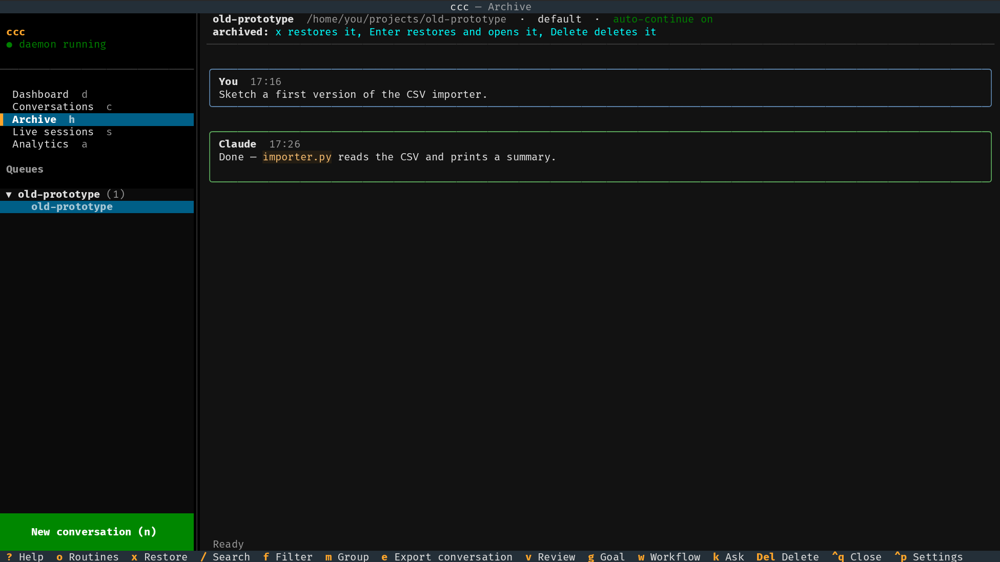

# Archive

Conversations you're done with go to the Archive (`h`) — out of the way,
but nothing is lost. When the Archive is empty it says **EMPTY**.

## Archiving

`x` in [Conversations](conversations.md) archives the selected
conversation. It disappears from Conversations and the Dashboard and
shows up in the Archive.

- A conversation with **Claude Code beside ccc** stops: its Claude Code
  process ends (freeing its memory) and its queued tasks wait.
- A **headless** conversation keeps working through its queue.

## Restoring

In the Archive:

| Key | |
|---|---|
| `x` | restore the conversation — it goes back to Conversations |
| `Enter` | restore it and open it in Conversations |
| `Delete` | delete it from ccc (asks first) |
| `/` | search all conversations |
| `f` | [filter the list](conversations.md#filtering-the-list); `Enter` shows the first result (doesn't restore it) |
| `e` | export it as Markdown |

A restored conversation continues where it was: Claude Code starts again
with its whole history (`--resume`), waiting tasks go on.

## Deleting

You can only delete a conversation from the Archive — archive it first.
ccc asks before deleting. What goes and what stays:

- **Goes:** the conversation in ccc, its queued tasks and the texts of
  its runs.
- **Stays:** its token numbers in [Analytics](analytics.md) (shown as
  *deleted*) and Claude Code's own transcript — you can still pick the
  session under *Resume selected…* when
  [starting a conversation](new-conversation.md).

A conversation Claude is working on can't be deleted until it finishes or
you pause it (`t`, `p`).
