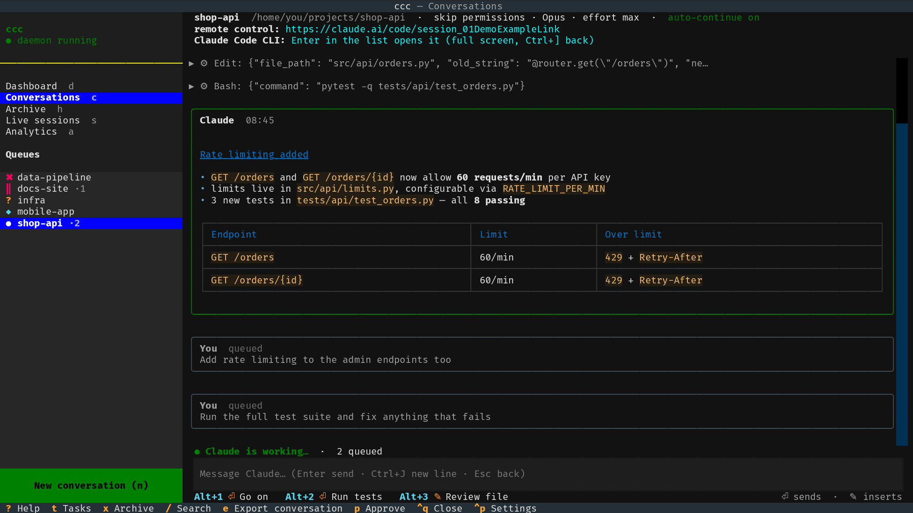

# Conversations

Conversations (`c`) is where you work with Claude. On the left is the list
of your conversations, on the right the selected one. Move in the list
with `↑` `↓` — the right side follows at once.

## The list

Each conversation shows a marker in front of its name and `·N` behind it
when N tasks wait in its [queue](tasks.md):

| Marker | Meaning |
|---|---|
| `●` | Claude is working |
| `‖` | waiting for a usage-limit reset, or paused |
| `✖` | stopped on an error — needs you |
| `?` | Claude is waiting for you to [approve a tool call](approvals.md) |
| `◆` | a new reply you haven't looked at yet |

Behind the name is how full the conversation's context window is, e.g.
`62%` — yellow from the warning threshold, red from the alarm (see
*Context fill* below).

With no conversation at all, the right side says **NO CONVERSATION** —
press `n` to start one.

## Filtering the list

With dozens of conversations, `f` opens a filter above the list. Type
and the list narrows to conversations whose **name or folder** contains
what you typed — case and diacritics don't matter (`prilis` finds
*Příliš*); several words must all match.

Markers at the start filter by **state** — each a word of its own,
combined with text as you like (`? api`, `!? api`, `x`):

| Marker | Shows |
|---|---|
| `!` | Claude is working |
| `?` | waiting for your approval |
| `x` | stopped on an error |
| `*` | a new reply you haven't seen |

Several markers show any of those states. `Enter` opens the first result,
`Esc` cancels the filter. While it's on, the list's title says so
(`Queues · filter: api`); when nothing fits, the list says *Nothing
matches*. The filter stays while the list refreshes, until you cancel it
or leave the view; the conversation you opened from it stays listed even
when it stops matching (a `*` one is no longer new once you look at it).
The key can be changed in Settings → Keyboard shortcuts. It works the
same in the [Archive](archive.md).

## Claude Code beside ccc

A conversation started with `n` runs the **real Claude Code** — the same
as typing `claude` in a terminal, with every feature: slash commands,
tool approvals, `Shift+Tab`, `Esc Esc`, history, images. ccc shows it to
the right of its menu:

| Key | |
|---|---|
| `Enter` on a conversation | open its Claude Code and put the keyboard there |
| `Alt+0` | switch the keyboard between ccc and Claude (or click where you want to type) |
| `Ctrl+]` | close Claude's pane — Claude keeps running, `Enter` opens it again |
| `Alt+N` | open the next conversation that needs you, here in the pane (also from Claude Code) |
| select with the mouse | copies to your clipboard (also over SSH and in Termux) |
| `Ctrl+Shift+C` / `Ctrl+Shift+V` | copy the selection / paste the last copy |

Under Claude a bar shows your [preset prompts](settings.md) — click one
to use it. `Alt+0` and `Ctrl+]` are also in ccc's bar at the bottom.

**What needs you** shows in Claude's title bar, so you see it while you
type there — or when Claude takes the whole window on a phone, where the
list isn't visible: `? shop-api waits for approval · ✖ infra error ·
◆ docs-site done`. The same states as the list's markers — a tool
approval waiting, an error, paused at a usage limit, a finished run you
haven't seen — most urgent first, without the conversation you're in;
what doesn't fit ends as `+N more`. It's gone when nothing waits.
`Alt+N` opens the first one.

Good to know:

- Claude keeps running when you switch to another conversation or screen,
  close ccc (`Ctrl+Q`) or close the pane. The daemon keeps it alive in the
  background and starts it again with its history if it dies.
- Tasks from the [queue](tasks.md) are pasted into Claude whenever it's
  idle, as if you typed them.
- On a narrow window (under 100 columns, e.g. a phone) Claude takes the
  whole window; `Alt+0` gets you back to ccc.
- Every such conversation keeps a Claude Code process in memory —
  [archive](archive.md) (`x`) the ones you're done with.

## Headless conversations

Conversations that share a folder show a ⚠ line: their headless tasks
take turns, see [Git](git.md#several-conversations-in-one-folder).

Prompts queued with `+` (Live sessions, queue detail) or `ccc add` run
**headless**: the daemon runs `claude -p` for each task, without a
terminal. For these ccc shows the transcript itself:

- Claude's replies are rendered as Markdown; a tool call is a collapsed
  `▸ ⚙ Tool: …` line — `Enter` or a click shows its input and result.
- The **message box** under the transcript adds a message to the end of
  the queue: `Enter` sends, `Ctrl+J` starts a new line. `Alt+1` … `Alt+9`
  send or insert a [preset prompt](settings.md).
- The line above the box says what's going on: *Ready*, *Next task at
  23:00*, *Waiting for usage limit reset until 14:30*,
  *✖ Blocked: … — press r to retry*, …
- A headless run can't stop and ask you to approve a tool, so its
  permission mode is chosen up front — see
  [Approving tool calls](approvals.md).

## The header

At the top: the conversation's name, project folder and Claude Code
options, whether auto-continue is on, and for a
[remote-control](remote-control.md) conversation the link for your phone.

### Context fill

Below that: how full the context window is, e.g.
`context 62 % · 124k / 200k`. When it fills up, Claude Code compacts the
conversation by itself and details of the earlier work get lost — the
number tells you in time to run `/compact` or start a new conversation.
From 80 % it turns yellow, from 90 % red, with *consider /compact or a new
conversation*; both thresholds are in [Settings](settings.md) → Context.

It's the prompt of Claude's last reply (input + cache tokens, as in
Claude Code's `/context`) divided by the model's window:

- **1M** when the conversation's `--model` has `[1m]`, or it already
  went past 200k (only a 1M window holds that),
- the window chosen in Settings → Context → Window,
- otherwise **200k** for a Claude model.

A model ccc doesn't know shows only the tokens, without %. If your
model runs with the 1M window by default, choose *1M* in Settings —
otherwise the % comes out too high until the conversation passes 200k.

With Telegram or Discord set up, ccc tells you once when a conversation
reaches the warning (again only after it dropped below, e.g. after
`/compact`); turn it off in Settings → Context → Notify.

## Other keys

| Key | |
|---|---|
| `t` | the [task queue](tasks.md) of this conversation |
| `r` | stopped on an error: run the failed task again; paused at a limit: carry on — see [Usage limits](limits.md) |
| `p` | [approve a tool call](approvals.md) Claude is waiting on |
| `x` | [archive](archive.md) the conversation |
| `/` | search all conversations (archived too); `Enter` on a hit opens it |
| `f` | filter the list by name, folder and state (see *Filtering the list*) |
| `e` | export the conversation as Markdown (to `conversations/` in the export folder, see [Settings](settings.md)) |
| `n` | [start a new conversation](new-conversation.md) |
