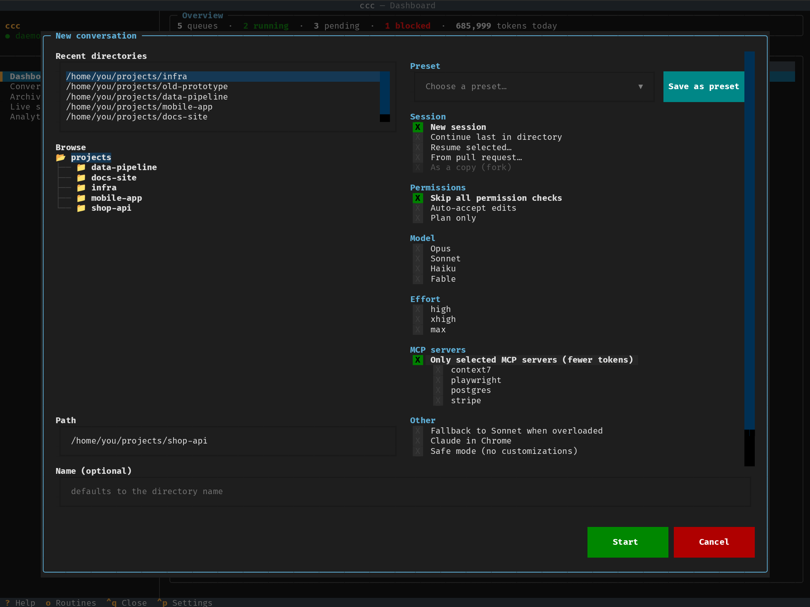

# Zahájení konverzace

Kdekoli stiskni `n` (nebo zelené tlačítko **Nová konverzace**
v Konverzacích). Okno má dvě poloviny.

## Složka

Složka projektu, ve které bude Claude pracovat: vyber některou
z nedávných, projdi strom složek, nebo napiš cestu.

## Volby

Stejné přepínače jako na příkazové řádce `claude`. Skupiny označené
*jedna* dovolí jen jednu volbu.

| Skupina | Volby |
|---|---|
| Relace (*jedna*) | **Nová relace** · **Pokračovat v poslední ve složce** · **Obnovit vybranou…** (vybereš některou z dřívějších relací Claude Code v této složce) · **Z pull requestu…** |
| | **Jako kopie (fork)** — s Pokračovat / Obnovit / Z PR: nová konverzace, která z té původní vychází; původní zůstane, jak byla |
| Oprávnění (*jedna*) | **Přeskočit všechny kontroly oprávnění** — Claude dělá všechno bez ptaní · **Automaticky přijímat úpravy** — úpravy souborů ano, ostatní nástroje se ptají · **Ptát se na vše** — ptá se každý nástroj, i úpravy · **Jen povolené** — co ještě není povolené, se odmítne, nic se neptá · **Automatický režim** — Claude Code sám rozhoduje, co je bezpečné · **Jen plán** — Claude jen plánuje |
| Model (*jedna*) | Opus · Sonnet · Haiku · Fable |
| Úsilí (*jedna*) | high · xhigh · max |
| MCP servery | **Jen vybrané MCP servery (méně tokenů)** — viz [MCP servery](#mcp-servery) |
| Ostatní | Při přetížení přejít na Sonnet · Claude v Chromu · Bezpečný režim |
| | **Vlastní git worktree** — samostatná pracovní kopie a větev pro tuto konverzaci (`.claude/worktrees/<název>`, větev `worktree-<název>`), aby mohla pracovat vedle ostatních ve stejném repozitáři; jen s novou relací nebo z pull requestu a s *Přeskočit všechny kontroly oprávnění* (ccc spouští git jen tam). Viz [Git](git.md#více-konverzací-v-jedné-složce) |

Pod nimi:

- **Automaticky pokračovat po limitu využití** (výchozí zapnuto) — když
  Claude narazí na tvůj limit využití, konverzace počká na obnovení
  a sama pokračuje. Vypnuto: zastaví se a čeká na tebe. Viz
  [Limity využití](limits.md).
- **Vzdálené ovládání (telefon / claude.ai)** — v konverzaci můžeš
  pokračovat i z mobilní aplikace Claude. Viz
  [Vzdálené ovládání](remote-control.md).

Nic nezaškrtnuto znamená výchozí nastavení Claude Code.

## MCP servery

Claude Code ve výchozím stavu načte každý MCP server, který najde — tvoje
z `~/.claude.json`, `.mcp.json` ve složce i konektory z claude.ai (Gmail,
Vercel…) — a definice všech jejich nástrojů dává do kontextu každého tahu.
Při pár velkých serverech jsou to stovky nástrojů a spousta tokenů, které
platíš s každou zprávou, ať je konverzace potřebuje, nebo ne. (Jedno
měření: 543 nástrojů bez výběru, 24 bez serverů.)

Zaškrtni **Jen vybrané MCP servery** a pod tím se objeví servery nastavené
pro zvolenou složku; zaškrtni ty, které smí konverzace používat. Nic
nezaškrtnuto znamená žádné. Vlastní server ccc (schvalování, ptaní se
jiných konverzací) je zapnutý vždy. Výběr platí pro celou konverzaci,
pamatuje se na příště a ukládá se do předvoleb.

- Konektory z claude.ai vybírat nejde: s touto volbou jsou všechny vypnuté.
- Server z `.mcp.json` ve složce se nabídne až poté, co jsi ho pro tu
  složku schválil v Claude Code (zeptá se při prvním použití); repozitář
  tak nemůže spustit příkaz jen tím, že server definuje.
- Server, který jsi mezitím z konfigurace odstranil, se přeskočí.
- ccc ukládá jen názvy, nikdy nastavení serverů (mohou obsahovat tokeny);
  nastavení se čte při startu Claude Code.

## Předvolby

Okno si pamatuje tvou poslední volbu. Pokud často používáš pár
kombinací, **Uložit jako předvolbu** uloží tu aktuální pod názvem;
**Vyber předvolbu…** jí okno vyplní. Předvolby mažeš
v [Nastavení](settings.md).

## Po Spustit

Jsi v [Konverzacích](conversations.md) a vedle ccc je otevřené Claude
Code. Obnovení relace, která už v ccc konverzaci má, jen přepne na tu
konverzaci — pokud nezaškrtneš *Jako kopie (fork)*.
