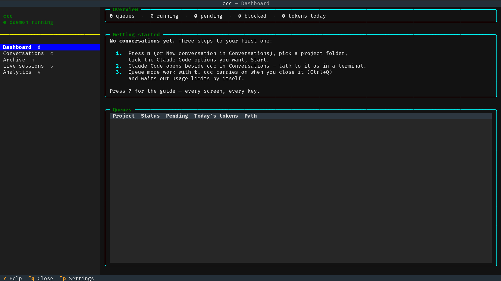

# Getting started

ccc is a home for your Claude Code work that **keeps going without you**.
You start conversations with Claude Code in your projects, queue up
tasks for them, and a background daemon works through the queue: it waits
out usage limits and carries on by itself, asks you when Claude needs
approval, commits finished work and tells you on Telegram or Discord.

## Two parts: the daemon and the TUI

- **The daemon** (`ccc.service`) does all the work. It runs in the
  background all the time — also when no ccc window is open, after you
  log out of SSH, after a reboot.
- **The TUI** — what you're looking at — is only a window onto it: you
  read conversations, queue tasks and change settings here. Close it any
  time; nothing stops.

The sidebar shows whether the daemon runs: **● daemon running**. If it
says *daemon not running*, nothing gets done — see
[Troubleshooting](troubleshooting.md).

## Opening and closing ccc

- `ccc` in any terminal (local or over SSH) opens ccc. There is only ever
  one ccc: every terminal shows the same screen.
- `Ctrl+Q` closes it in this terminal. ccc keeps running and so does the
  queued work; `ccc` opens it again.

## Your first conversation

1. Press `n`. Pick the **project folder** Claude should work in, tick the
   Claude Code options you want (model, permissions, …) and press
   **Start**. See [Starting a conversation](new-conversation.md).
2. You're in **Conversations**: the real Claude Code opens to the right
   of ccc's menu. Talk to it exactly as in a terminal. `Alt+0` switches
   the keyboard between ccc and Claude. See [Conversations](conversations.md).
3. Want Claude to do more after this? Press `t` and add **tasks**: they
   run one after another, each as soon as Claude finishes the previous
   one — also at night, also after a usage limit resets. See
   [Task queue](tasks.md).

## Finding your way around

Every screen looks the same:

- **Left:** ccc's menu — the screens with their keys (`d` Dashboard, `c`
  Conversations, `h` Archive, `s` Live sessions, `v` Analytics; click
  them too), the screen's own list, and its buttons.
- **Right:** the screen itself.
- **Bottom bar:** the keys of the screen you're on, plus `?` Help,
  `Ctrl+Q` Close and `Ctrl+P` Settings. Click a key to press it.

Keys without `Ctrl` or `Alt` (like `n`, `t`) don't work while you're
typing in a text field — click the list on the left
first.

## What next

- [Usage limits & blocked queues](limits.md) — what happens when you hit
  your Claude limit, and how to keep part of it for yourself.
- [Settings & notifications](settings.md) — colour theme, Telegram /
  Discord messages, preset prompts.
- [Remote control (phone)](remote-control.md) — continue a conversation
  from the Claude app.
- [Keyboard shortcuts](keys.md) — every key on one page.
