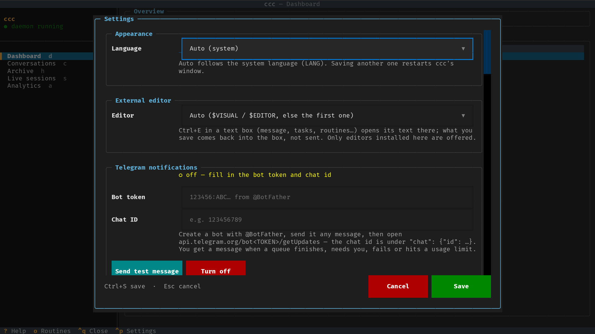
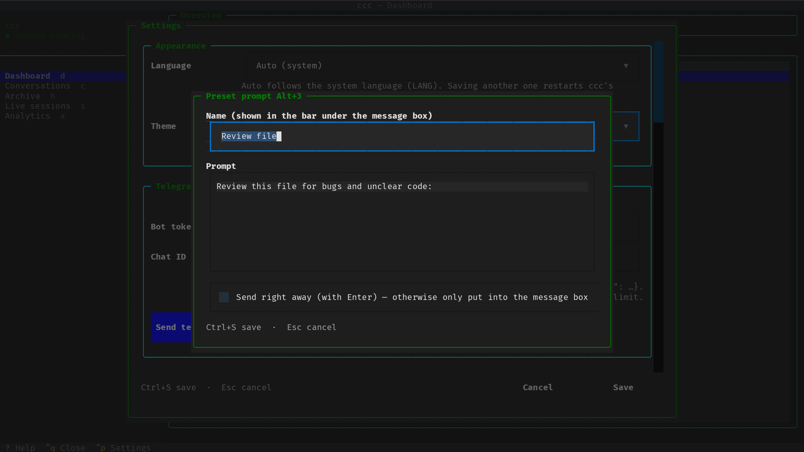

# Settings & notifications

`Ctrl+P` opens Settings — everything you can change, in one window.
Change what you need, then `Ctrl+S` (*Save*). `Esc` (*Cancel*) throws the
changes away. Buttons like *Send test message*, *Turn off* or *Back up
now* act right away.

## Sections

The window has a tab for each kind of setting (`←` `→` or a click switch
between them); *Save* applies every tab at once:

| Tab | Sections |
|---|---|
| General | Appearance, External editor, Dashboard, Keyboard shortcuts |
| Queues and context | Queues, Context |
| Notifications | Telegram, Discord |
| Presets | Preset prompts, New-conversation presets |
| Data | Exports, Monthly analytics archive, Data |
| Connection and updates | Pair a new device, Devices, Updates |

The Android app's *ccc settings* has the same kinds of tabs (plus
*Connection*, which opens the app's own sign-in and devices screen).

| Section | |
|---|---|
| Appearance | language — *Auto* follows the system (`LANG`), saving another one restarts ccc's window |
| External editor | the editor `Ctrl+E` opens a text box's text in — see below |
| Telegram notifications | see below |
| Discord notifications | see below |
| Queues | the *continue* text sent after a usage limit, and the usage reserve — see [Usage limits](limits.md); the [reviewer's](review.md) model; *Groups in the list* — by project, or only your own groups (see [Conversations](conversations.md#groups)) |
| Context | the context window size and the warning / alarm thresholds of the context fill, and the Telegram / Discord message when a conversation reaches the warning — see [Conversations](conversations.md) |
| Preset prompts | your prompts on `Alt+1` … `Alt+9` — see below |
| New-conversation presets | delete presets saved in the [New conversation](new-conversation.md) window |
| Keyboard shortcuts | change any key, export / import them — see below |
| Exports | the folder for exported conversations (`e`) and screenshots (`Alt+S`); optionally send each export to Telegram / Discord |
| Monthly analytics archive | see [Analytics](analytics.md) |
| Updates | look for new versions of ccc, on or off — see below |
| Pair a new device | a QR code for the Android app — see [Android app & API](android-api.md) |
| Devices | the list of phones signed in to the Android app's API, right in the tab: change role, sign one out, history, activity — see [Android app & API](android-api.md) |
| Data | where the database and its daily backups are, *Back up now* |

The same values can be set from the shell, see
[Command line](command-line.md).

## Preset prompts

Prompts you type again and again — "go on", "run the tests and fix what
fails", "review this file: " — saved once, used in any conversation with
`Alt+1` … `Alt+9`.

- **Set up:** *Preset prompts* → *Add* / *Edit*: a **name** (shown in the
  bar), the **prompt** and **the “sent to the conversation” checkbox**. *Up* /
  *Down* set the order — the first is `Alt+1`. Up to 9.
- **Use:** press the key or click the preset in the bar.
  - `⏎` presets are **sent** at once.
  - `✎` presets are **put into the message box** (or Claude's input) for
    you to finish, e.g. add a file name.

## External editor

Long prompts are easier to write in a real editor. `Ctrl+E` in any text
box — the message box in Conversations, the task, routine, goal, review,
workflow and ask windows — opens its text in the editor chosen here.
ccc steps aside until you close the editor (also in tmux and over SSH);
what you saved comes back into the box — it isn't sent, you can still
change it. Closing without saving changes nothing.

*Editor* offers only editors installed on this machine (`nano`, `micro`,
`vim`, `nvim`, `emacs -nw`, `hx`, `kak`…), graphical ones (`code --wait`,
`gedit --wait`…) only when there's a display. *Auto* uses `$VISUAL` /
`$EDITOR`, else the first one found. The text goes through a file only
you can read in ccc's folder, deleted right after. `Ctrl+E` can be
changed like any key.

## Keyboard shortcuts

Every key in ccc can be changed: *Keyboard shortcuts* → *Edit
shortcuts…* opens a window listing every action with its key (changed
ones in yellow).

- **Change:** pick an action, then *Press the key* and press its new key
  (any key — Esc, Ctrl+P too), or type its name (`Ctrl+O`, `Alt+S`, `F5`,
  `+`) and *Set*. *Default* puts one back, *All defaults* all of them.
- **Checked first:** a key that collides is refused, and the window says
  why — it's never saved. A collision is:
  - another action on the same key where both work at once (e.g. two
    views, or a view and a key that works everywhere),
  - a key the terminal can't tell apart (Ctrl+I is Tab, Ctrl+M is Enter,
    Ctrl+H is Backspace), Ctrl+C, Ctrl+B (tmux's prefix) or
    Ctrl+Shift+C / V (copy / paste),
  - a key the lists and text fields need (arrows, Enter, Tab, Space,
    editing keys like Ctrl+A / E / K / U / W),
  - for keys that also work from the Claude Code pane (switch, close
    Claude, presets, Settings, screenshot, close ccc): one of Claude
    Code's keys (Ctrl+T, Ctrl+O, Ctrl+R, Alt+P, …), or a key without
    Ctrl / Alt (F-keys are fine) — it couldn't be typed into Claude
    Code any more.
- **Save** (`Ctrl+S`) and the new keys work right away — the menu, the
  buttons and `?` show them. This window saves on its own, independently
  of Settings' Save.
- **Export / Import:** type a folder (the export folder is prefilled) —
  *Export* writes `ccc-keys.json` there, *Import* reads it (or the file
  you name) and is checked the same way: one collision and nothing is
  imported. Copy the file to another machine to take your keys along.

The same from the shell: `ccc keys` (see [Command line](command-line.md)).
The other pages of this guide name the default keys.

## Telegram notifications

ccc messages you when a conversation **finished its queue**, **stopped on
an error**, **needs you** (paused at a limit, a tool approval waiting) or
**hit a usage limit** and later **continues**.

1. In Telegram, create a bot with [@BotFather](https://t.me/BotFather)
   (`/newbot`) and copy its token.
2. Send your bot any message, then open
   `https://api.telegram.org/bot<TOKEN>/getUpdates` in a browser and copy
   the number after `"chat":{"id":`.
3. Fill in both in Settings, press *Send test message*, then *Save*.

## Discord notifications

The same messages can go to a Discord channel — instead of Telegram or
as well.

1. In Discord: the channel's settings → *Integrations* → *Webhooks* →
   *New Webhook* → *Copy Webhook URL*.
2. Paste it in Settings, press *Send test message*, then *Save*.

Keep the URL private: anyone who has it can post to the channel.
Tokens and webhooks are stored in ccc's database, shown masked and never
logged.

## Which messages each service gets

Under each service in Settings (and in the app: *Settings → Notifications*)
*Choose messages…* opens a window with a tick for every kind of message.
Telegram and Discord have **their own choice**, so one can get everything
and the other only what needs you. Saved with *Save* in the app, at once
(`Ctrl+S`) in the terminal.

| Kind | What it tells | Default |
|---|---|---|
| Queue | a queue finished, or stopped on an error | on |
| Usage limits | waiting for the limit to reset, and continuing | on |
| Needs you | a tool to approve, a workflow gate, an answer to a question | on |
| Results | a workflow, a goal or a review ended | on |
| Context | a conversation's context is nearly full (also needs the *Context* setting) | on |
| Updates | a new ccc version is available | on |
| Conversation started | a conversation starts working after 10+ quiet minutes | off |
| Routines | a routine started, or was skipped | off |
| Devices | a new device paired, signed out, or its role changed | on |
| Security | a wrong pairing code or token, a forbidden request | on |
| Health | a failed backup, a new warning in `ccc api doctor` | off |
| Daily summary | after 8:00, what ran in the last 24 hours | off |

A kind that was never set keeps its default, so nothing changes until you
tick or untick something.

## Secrets are masked

Whatever leaves ccc — every Telegram / Discord message and every exported
conversation (`e`) — has secrets replaced by `[redacted]` first: API keys
and tokens with a known shape (`sk-ant-…`, `ghp_…`, `AKIA…`, Slack, Stripe,
JWTs, private-key blocks…), passwords in URLs, `Bearer …` headers, and
values named like a secret (`DB_PASSWORD=…`, `"client_secret": …`). The
recognisable prefix stays, so `ANTHROPIC_API_KEY=sk-ant-[redacted]` still
tells you what was there. It's a safety net, not a guarantee: a secret with
no known shape and no telling name gets through. Screenshots (`Alt+S`) are
pictures of the screen and are not masked.

## Backups

The daemon backs up ccc's database every day and keeps the last 14
(`~/.local/share/ccc/backups/`). To restore one, see
[Troubleshooting](troubleshooting.md).

## Updating ccc

A new version is a **release on GitHub**, by the same rules as the Android
app: its tag is a version `X.Y.Z` (a leading `v` is fine), it is not a draft
or prerelease, and it has `ccc.tar.gz` attached (the release build makes it
from the tag, [see below](#releasing)). Versions are compared as numbers. A ccc
whose version isn't a number (a build made by hand, `0.0.0-dev`) uses the
newest tag its checkout contains; with none, it never asks.

Every few hours the daemon looks (one request to GitHub, no token, nothing is
changed) and, when there is a newer release, tells you:

- in ccc: a yellow line *⬆ Update* under the title, on every screen — `U`
  (or a click on it) opens the **Update** window with the release notes;
- on the phone: a banner in the Android app's list, with the same button
  ([Android app & API](android-api.md));
- in Telegram and Discord, once for each new version.

*Update now* moves ccc to that release and restarts it (an interactive
conversation's Claude Code keeps running; ccc and the API are back in a
moment). It asks first and never runs by itself. How it moves depends on how
ccc is installed:

- **a git checkout** (`bin/install.sh`, the usual way): it fetches the
  release's tag and fast-forwards the checkout to it — not to whatever is
  newest on `main` — then runs `bin/install.sh` with the options ccc was
  installed with. It refuses — and says why — when the checkout is not on
  `main`, has uncommitted or unpushed changes, the release isn't a
  fast-forward of it, or a task is running;
- **the system package** (`.deb`, `apt install ccc`): the package manager
  updates it — `sudo apt update && sudo apt upgrade`, then
  `systemctl --user restart ccc ccc-tui`. ccc only tells you there is a
  newer release; *Update now* explains this and changes nothing. After
  `apt upgrade` the services still run the old code until they restart: ccc
  notices (the files on disk are a different version than the running TUI, API
  or daemon) and shows **↻ restart needed — click** under *daemon running* —
  a click restarts `ccc`, `ccc-tui` and `ccc-api`, but only while no task runs
  (the phone has the same line and button). The conversations keep running.
  The first upgrade *to* a version that has this line cannot show it yet;
  restart by hand once: `systemctl --user restart ccc ccc-tui ccc-api`;
- **a package** (pip / pipx): it downloads the release's `ccc.tar.gz` and
  `pip install`s it into the environment ccc runs from.

The install's output is in `~/.local/share/ccc/update.log`. The Android app is
updated separately, from the releases of its own repository
([Android app & API](android-api.md#updating-the-app)).

*Settings → Updates → Look for updates* turns the looking (and these
messages) off; the window shows what failed when GitHub can't be reached.

### Releasing

`~/Documents/CC/bin/ccc-android-release.sh 0.2.0` (or just pushing the tag
`0.2.0`, no `v`) runs `.github/workflows/release.yml`: it creates the release
(or keeps one made by hand), runs the tests, stamps the tag into
`ccc.__version__` and attaches `ccc.tar.gz`. An artifact already on a release is
never replaced.

The same run builds and tests the system package (`ccc_all.deb`, for the
Icenux APT repository) but does not attach it: the signing key stays on the
maintainer's machine (`~/.config/ccc-release/`, outside the repository). When the
run is green, `~/Documents/CC/bin/ccc-deb-sign-upload.sh 0.2.0` downloads the
package, signs `SHA256SUMS` and attaches `ccc_all.deb`, `SHA256SUMS` and
`SHA256SUMS.asc` to the release; Icenux takes the package from there.
